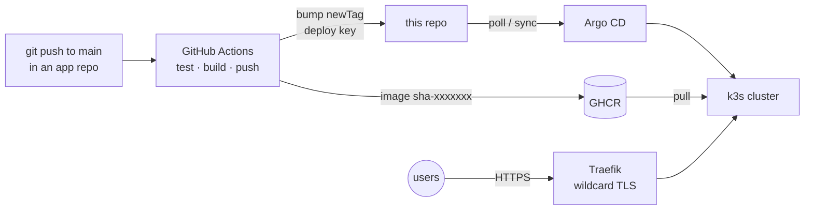

# devops-marathon-gitops

GitOps repository for **devops-marathon**, my personal platform on a single-node **k3s** cluster
(`devopsdelisi.fun`). Everything that runs in the cluster is declared here and reconciled by
**Argo CD** (app-of-apps). Apps live in their own repos; their CI builds an image and bumps the
tag here, and Argo CD rolls it out. No `kubectl apply` except the one-time bootstrap.



## What runs here

| App | What | Source | URL |
|---|---|---|---|
| **kubenotes** | Go + Templ + HTMX app: shared notes on Kubernetes resources and a live cluster map. Read-only RBAC, SQLite on a PVC, app login with a Traefik rate limit on `/login` | [barisMarathon/kubenotes](https://github.com/barisMarathon/kubenotes) | https://kubenotes.devopsdelisi.fun |
| **catjob** | Node.js app with a frontend/backend split, Postgres StatefulSet and a nightly `pg_dump` CronJob | private repo | https://catjob.devopsdelisi.fun |
| **hello** | Static page on unprivileged nginx, the CI/CD smoke test | [barisMarathon/devops-marathon-hello](https://github.com/barisMarathon/devops-marathon-hello) | https://blog.devopsdelisi.fun |

Platform components:

| Component | Details | Sync wave |
|---|---|---|
| Argo CD | Self-managed from upstream `install.yaml` v3.5.6, trimmed with kustomize (no Dex, notifications, ApplicationSet) | -1 |
| cert-manager | Helm chart v1.21.3 | 0 |
| ClusterIssuers | Let's Encrypt staging + prod, DNS-01 via Cloudflare | 1 |
| Traefik config | k3s-bundled Traefik: wildcard `*.devopsdelisi.fun` cert as default TLS, HTTP→HTTPS redirect, hostPort binding | 2 |
| Apps | kubenotes, catjob, hello | 3 |

## Layout

```
bootstrap/root-app.yaml   the only manifest applied by hand: points Argo CD at apps/
apps/                     one Argo CD Application per component (sync waves set the order)
manifests/<component>/    kustomize bases; CI only ever edits newTag in kustomization.yaml
```

## How a deploy works

1. A push to `main` in an app repo runs its CI: tests, image build, push to
   `ghcr.io/barismarathon/<app>:sha-<7>`.
2. CI checks out this repo with a per-app **deploy key** (write access, nothing else), sets
   `newTag` in `manifests/<app>/kustomization.yaml` and pushes as `github-actions[bot]`
   (with `pull --rebase` retries, since several apps push here).
3. Argo CD picks up the commit and syncs with `prune` + `selfHeal`.
4. Rollback = `git revert` of the bump commit.

PRs in app repos only build; nothing is deployed until merge. Forked PRs never see the deploy key.

## Design notes

- **Wildcard certificate, one secret.** A single `*.devopsdelisi.fun` cert (DNS-01) is Traefik's
  default TLS store, so new apps need no TLS config at all.
- **Real client IPs.** k3s ServiceLB (klipper) masquerades traffic, so Traefik only saw pod IPs.
  Traefik binds 80/443 via `hostPort` with a ClusterIP Service instead, which keeps IP-based
  middleware (rate limits, allow-lists) meaningful. Rollouts stop the old pod first.
- **Stateful data is protected from Git mistakes.** PVCs carry
  `argocd.argoproj.io/sync-options: Prune=false,Delete=false`.
- **Least privilege.** Apps run non-root with read-only root filesystems and dropped
  capabilities; kubenotes' ClusterRole is `get/list/watch` only.
- **Private by default.** SSH, the Kubernetes API and the Argo CD UI are reachable only over
  Tailscale; only 80/443 are public.

## Bootstrap (once per cluster)

The host itself (hardening, ufw, Tailscale, k3s) is provisioned with Ansible from a separate,
private infra repo.

```bash
export KUBECONFIG=~/.kube/devops-marathon.yaml

# 1. Install Argo CD from the same manifests it will later manage itself with
kubectl apply -k manifests/argocd --server-side --force-conflicts
kubectl -n argocd rollout status deploy/argocd-server deploy/argocd-repo-server
kubectl -n argocd rollout status statefulset/argocd-application-controller

# 2. Cloudflare API token for DNS-01 (Edit zone DNS, scoped to devopsdelisi.fun only)
kubectl create namespace cert-manager
kubectl -n cert-manager create secret generic cloudflare-api-token \
  --from-literal=api-token='<CLOUDFLARE_API_TOKEN>'

# 3. Hand control over to Git
kubectl apply -f bootstrap/root-app.yaml
```

App secrets (database passwords, image pull credentials) are created by hand once per cluster.

## Operating

```bash
kubectl -n argocd get applications                       # all Synced / Healthy
kubectl -n argocd annotate application <app> \
  argocd.argoproj.io/refresh=hard --overwrite            # sync now instead of waiting for the poll

# Argo CD UI (Tailscale only)
kubectl -n argocd port-forward svc/argocd-server 8080:443
```

## Secrets

No secrets are stored in this repo. The few that exist (Cloudflare token, app DB passwords,
pull secrets) are created by hand; moving them to Sealed Secrets or SOPS is on the roadmap.

## Roadmap

- Sealed Secrets / SOPS for the remaining hand-made secrets
- Shared Postgres (CloudNativePG) with off-site backups to object storage
- Metrics and alerting (Prometheus + Grafana)
- Reusable CI workflow so a new app only needs a Dockerfile
